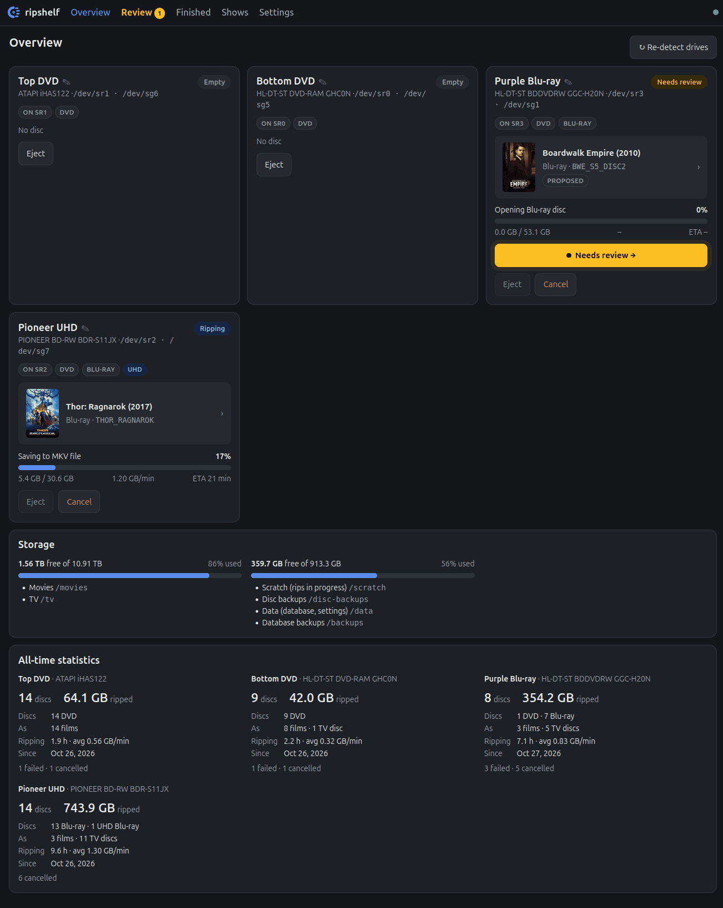
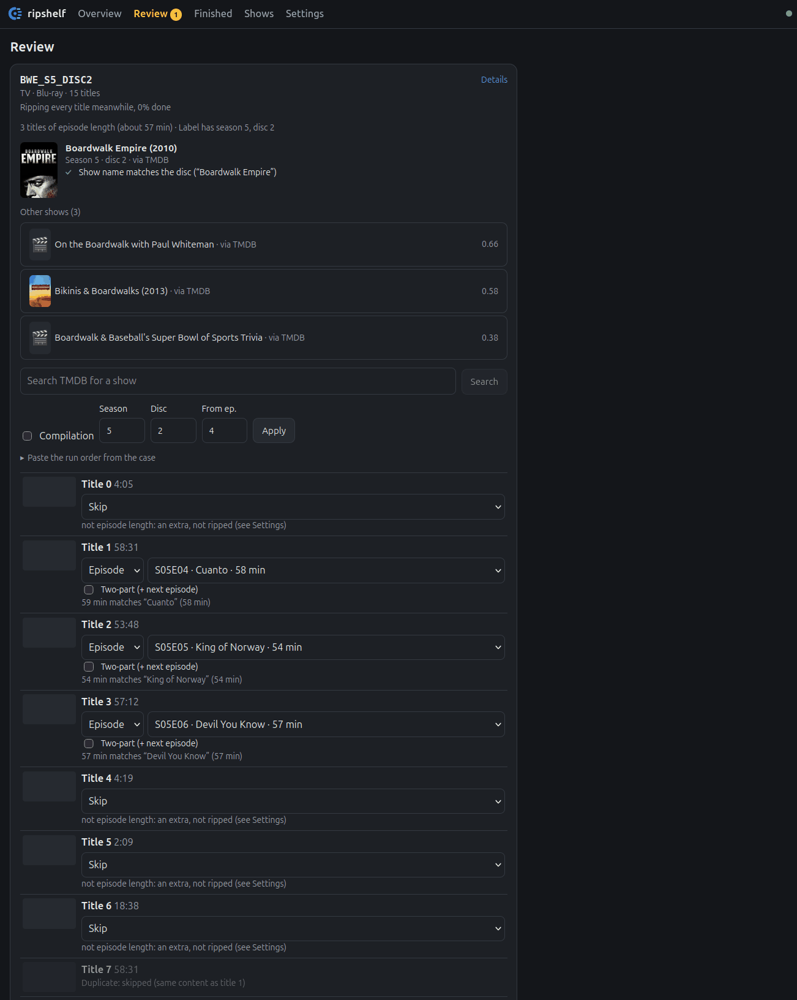
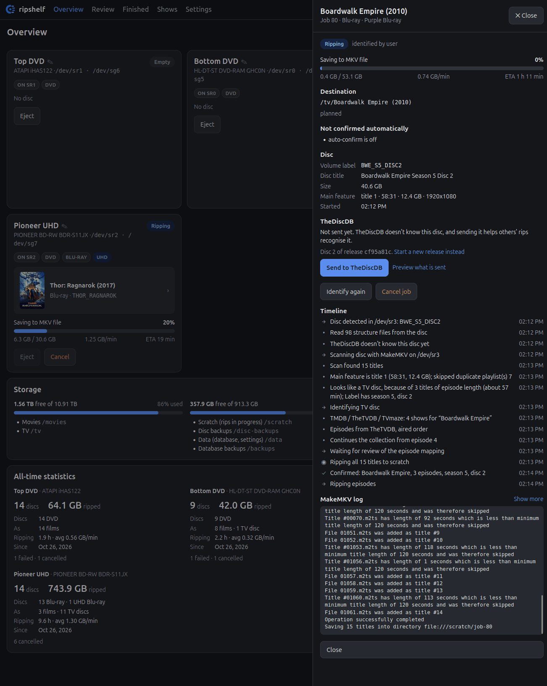

<p align="center">
  
</p>

<h1 align="center">ripshelf</h1>

<p align="center">
  Automatic DVD, Blu-ray and UHD Blu-ray ripping with MakeMKV.<br>
  Identifies each disc and files films and TV episodes into a library.
</p>

<p align="center">
  <a href="https://github.com/WillBeasley/ripshelf/actions/workflows/test.yml"></a>
  <a href="https://github.com/WillBeasley/ripshelf/actions/workflows/images.yml"></a>
  <a href="https://github.com/WillBeasley/ripshelf/releases/tag/v0.3.0"></a>
  <a href="https://github.com/WillBeasley/ripshelf/pkgs/container/ripshelf"></a>
  <a href="LICENSE"></a>
</p>

## Overview

ripshelf watches your optical drives. When a disc goes in, it works out what the disc is, rips it with MakeMKV, optionally transcodes it, and files it into an Emby-style library (the layout Jellyfin and Plex use too), then ejects the disc and tells you it's done.

Discs are identified from several sources, and each candidate gets a score and the evidence behind it. TV episodes are mapped by runtime and their order is checked. The web UI shows every job as it runs. When ripshelf isn't sure what a disc is, it asks you to confirm, and the rip carries on while it waits.

## Features

**Identification**
- **TheDiscDB.** Discs in [TheDiscDB](https://thediscdb.com) are recognised by fingerprint, including which title is the film and which is each episode.
- **Several metadata providers.** TMDB, TheTVDB, TVmaze and OMDb are asked in an order you choose, separately for films, shows and episode lists.
- **TV discs.** Shows are found from the disc label, episodes are mapped by runtime in aired or DVD order, and extras are kept apart.
- **Catalogue numbers.** Labels that are a catalogue number (`EO51710`) can be looked up on the web.
- **Review.** Uncertain discs wait on the Review page with candidates, scores and evidence. Confirmed discs can be contributed back to TheDiscDB (opt-in).

**Ripping**
- **MakeMKV, including UHD.** Each drive has its own LibreDrive data and firmware dumps, imported once in the UI.
- **Titles or full backups.** Each drive rips the main feature or every episode as MKV, or makes a decrypted backup of the whole disc.
- **Several drives at once.** Run them in one container, one container per drive, or on remote machines (amd64, arm64 and Windows).
- **Drive ids.** A drive is identified by its vendor, model and serial number, so its name, settings and statistics stay with it on another port or machine.

**After the rip**
- **Optional transcoding.** VC-1 (or other codecs) is re-encoded to H.265 on the GPU or CPU, with black bars cropped. HDR is left alone.
- **Library copies.** Files are checked by SHA-256, never overwritten, and get Emby-style names.
- **Integrations.** Emby, Jellyfin and Plex library refresh, and Pushover notifications.

**The web UI**
- Drive progress, MakeMKV and transcode logs, storage and hardware status, and a setup checklist.

## Screenshots

<p align="center">
  <br>
  <em>The Overview page shows each drive live, with storage and all-time statistics per drive</em>
</p>

<table>
  <tr>
    <td width="50%" valign="top"></td>
    <td width="50%" valign="top"></td>
  </tr>
  <tr>
    <td align="center"><em>Review, with a TV disc's titles mapped to episodes by runtime</em></td>
    <td align="center"><em>Job details, with the timeline, TheDiscDB and the MakeMKV log</em></td>
  </tr>
</table>

## Requirements

- **Linux with Docker** (or Podman) on amd64 or arm64, such as a Raspberry Pi 5. [Windows](docs/windows.md) runs natively without Docker.
- **One or more optical drives**, SATA or USB. For **UHD Blu-ray**, a [LibreDrive-capable drive](https://forum.makemkv.com/forum/viewtopic.php?f=16&t=19634) and its MakeMKV private data.
- **A MakeMKV key**, either a [purchased licence](https://www.makemkv.com/buy/) (please support MakeMKV) or the current free beta key.
- **A free TMDB API key** for identification; TheTVDB and OMDb keys are optional.
- **Scratch space**, about 100 GB free for a UHD rip.
- **Optionally**, an Intel or AMD GPU for hardware transcoding.

## Getting started

The prebuilt image covers amd64 and arm64, so all you need is [compose.yaml](compose.yaml).

> **No image is published yet.** It will be `ghcr.io/willbeasley/ripshelf`. Until then, [build the image yourself](docs/building.md).

1. Copy [compose.yaml](compose.yaml) into an empty folder and change the lines marked `<--`. These are your user and group ids, your drives (each `/dev/srN` with its `/dev/sgN`), your folders, and `RIPSHELF_ACCEPT_MAKEMKV_EULA`, which you set to `yes` once you have read and accepted [MakeMKV's licence](#legal).
2. Create the folders and start it:

   ```sh
   mkdir -p data scratch movies tv disc-backups backups
   docker compose pull && docker compose up -d
   ```

3. Open `http://<host>:8380` and follow the setup page. It asks for your drives, MakeMKV key, folders and TMDB key.

The full guide, with first-run configuration, tags and updating, is in **[docs/installation.md](docs/installation.md)**. Other ways to run it:

- [Build from source](docs/building.md), with Docker or [compose.build.yaml](compose.build.yaml)
- [One worker container per drive](docs/modes.md), faster with several drives
- [Remote workers](docs/workers.md) on other machines, including a Raspberry Pi
- [Natively on Windows](docs/windows.md)

> There's no login on the UI. Keep it on your LAN or behind a VPN.

## Support the projects ripshelf depends on

ripshelf depends on these projects, and most of them are free to use:

- **[MakeMKV](https://www.makemkv.com)** does all the ripping and decryption. The free beta key is a courtesy from its author while MakeMKV is in beta. If you use ripshelf, please [buy a MakeMKV licence](https://www.makemkv.com/buy/); the [forum](https://forum.makemkv.com) is where drive and UHD help lives.
- **[TheDiscDB](https://thediscdb.com)** only knows discs people have added. ripshelf can [help create disc submissions](docs/thediscdb-contributing.md) for you.
- **[TMDB](https://www.themoviedb.org)** and **[TheTVDB](https://thetvdb.com)** are community-edited, so fix a wrong runtime or a missing episode when you find one. TheTVDB also has a [subscription](https://thetvdb.com/subscribe) that funds it.
- **[TVmaze](https://www.tvmaze.com)** and **[OMDb](https://www.omdbapi.com)** are run by small teams and accept supporters.
- **[FFmpeg](https://ffmpeg.org/donations.html)** and **[SearXNG](https://github.com/searxng/searxng)** are open source, and a donation, a bug report or a star helps.

## Documentation

| Page | What it covers |
|---|---|
| [Installation](docs/installation.md) | the prebuilt image with Docker Compose, first-run configuration, tags and updating |
| [How it works](docs/how-it-works.md) | what happens to a disc, from scan to library, and how files are named |
| [Settings](docs/settings.md) | every setting and its environment variable |
| [Metadata providers](docs/providers.md) | TheDiscDB, TMDB, TheTVDB, TVmaze and OMDb, their keys, and the order they're asked in |
| [Contributing to TheDiscDB](docs/thediscdb-contributing.md) | sending confirmed discs back to TheDiscDB (opt-in) |
| [Catalogue numbers](docs/catalogue.md) | looking up catalogue-number labels on the web |
| [Full disc backups](docs/backup.md) | MakeMKV's backup ("ISO mode") instead of MKV titles |
| [One container or one per drive](docs/modes.md) | the single container, or a worker container per drive |
| [Remote workers](docs/workers.md) | drives on other machines, including a Raspberry Pi |
| [Windows](docs/windows.md) | running natively on Windows |
| [Building the image](docs/building.md) | building from source, another MakeMKV release or architecture |
| [CI on GitHub](docs/ci-github.md) | tests and published images |
| [Troubleshooting](docs/troubleshooting.md) | common problems and fixes |

## Getting help

Start with [Troubleshooting](docs/troubleshooting.md). It covers drives that aren't found, MakeMKV key and UHD decryption errors, scans that hang, and discs that go to Review. If that doesn't help, open an issue with the job's MakeMKV log (from the job panel) and the relevant lines from the Logs page.

## Contributing

Bug reports and pull requests are welcome. To run from source with simulated drives:

```sh
python3.12 -m venv .venv && .venv/bin/pip install -r requirements-dev.lock && .venv/bin/pip install --no-deps -e .
(cd web && npm ci && npm run build)
scripts/dev-fake.sh          # http://localhost:8381
.venv/bin/pytest
```

See [CONTRIBUTING.md](CONTRIBUTING.md) for the development setup, tests and code layout.

## Acknowledgements

ripshelf uses the following:

- [MakeMKV](https://www.makemkv.com) does the ripping and decryption. It is proprietary software by GuinpinSoft and needs its own key.
- [TheDiscDB](https://thediscdb.com), the community database of disc contents.
- [TMDB](https://www.themoviedb.org), [TheTVDB](https://thetvdb.com), [TVmaze](https://www.tvmaze.com) and [OMDb](https://www.omdbapi.com) for film and TV metadata.
- [FFmpeg](https://ffmpeg.org) and [x265](https://www.videolan.org/developers/x265.html) for transcoding, and [7-Zip](https://www.7-zip.org) for reading disc file systems.
- [SearXNG](https://github.com/searxng/searxng) web search for catalogue-number lookups.
- [FastAPI](https://fastapi.tiangolo.com) and [SvelteKit](https://svelte.dev).
- [Automatic Ripping Machine](https://github.com/automatic-ripping-machine/automatic-ripping-machine), an earlier automatic ripper that ripshelf takes ideas from.

This product uses the TMDB API but is not endorsed or certified by TMDB. Metadata provided by TheTVDB; please consider adding missing information or [subscribing](https://thetvdb.com/subscribe). TVmaze data is licensed CC BY-SA 4.0 and OMDb data CC BY-NC 4.0.

## Legal

ripshelf is for making personal backups of discs you own. It is not for copying discs you have borrowed or rented, or for sharing what you rip. You are responsible for how you use it.

- **Copy protection.** DVDs and Blu-rays are encrypted, and MakeMKV removes that encryption to read them. Laws on this differ from place to place, and some restrict it even for discs you own. You are responsible for checking and following the law where you live before using ripshelf.
- **MakeMKV.** ripshelf is not affiliated with, endorsed by or supported by MakeMKV or GuinpinSoft inc. MakeMKV is proprietary software under its own [EULA](https://www.makemkv.com), and needs a key from its author. The container image includes MakeMKV but does not accept its licence for you. ripshelf only runs it once you set `RIPSHELF_ACCEPT_MAKEMKV_EULA=yes`, which says you have read and accepted it. The setup page links to the licence text. Report problems with ripshelf in this repository, not on the MakeMKV forum.
- **Other services and trademarks.** ripshelf is not affiliated with TMDB, TheTVDB, TVmaze, OMDb, TheDiscDB, Emby, Jellyfin or Plex. Their names are trademarks of their owners and are used only to say what ripshelf works with.
- **No warranty.** ripshelf is provided as is, under the MIT licence. It reads optical drives and writes to your library folders, so keep backups of anything you care about.

This section is general information, not legal advice.

## Licence

ripshelf's own code is [MIT](LICENSE). The container image also contains MakeMKV, FFmpeg and other software under their own licences, listed with their obligations in [THIRD-PARTY-NOTICES.md](THIRD-PARTY-NOTICES.md).
